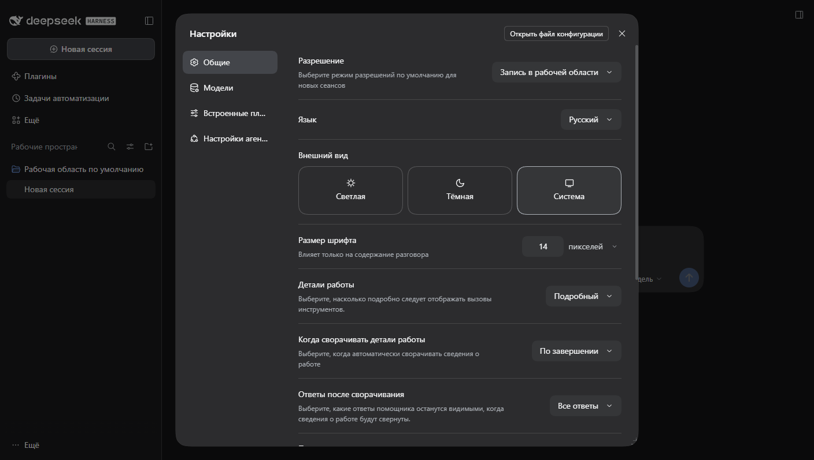
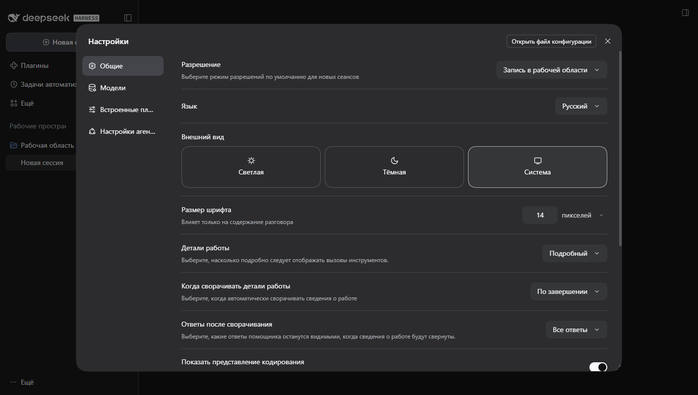
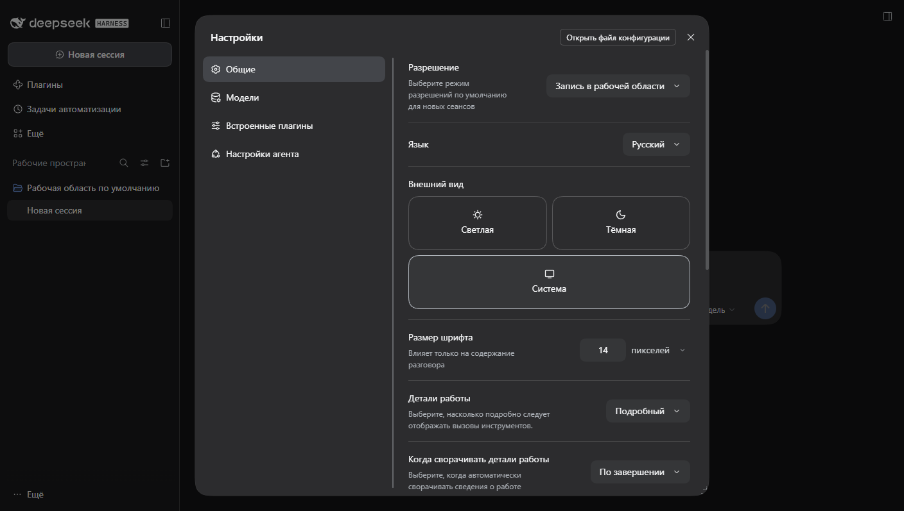

# dsh-settings-resizable

[](LICENSE)
[](CHANGELOG.md)
[](https://github.com/deepseek-ai)
[](package.json)

**Resizable Settings dialog for DeepSeek Harness.** Drag any edge or corner of the Settings window,
drag the divider between the navigation column and the options, hit the arrow keys on a focused
handle, and the dialog keeps the sizes you chose the next time you open it.

A local DeepSeek Harness (DSH) client plugin that makes the Settings dialog resizable. It adds
eight pointer handles to the edges and corners of the dialog plus one splitter between the
navigation column and the options, lets the user drag them or press the arrow keys to change the
sizes, remembers the chosen widths and height in `localStorage`, and clamps every size to the
viewport so the dialog can never grow past the window. The plugin is a pure web-UI decoration: it
never replaces the application root, never appends a second application, and never relies on
build-hashed class names.

**Version:** 0.2.0 · **License:** MIT · **Host half:** intentionally empty (all behaviour is in `client.js`)

## Screenshots



Default size on a 1408 × 797 viewport: 800 px wide, 749 px tall.



After dragging the right edge and the bottom edge, with the size persisted across a reload.



The navigation column dragged out to 308 px, with the options column reflowed beside it.

## Features

- Eight resize handles: north, south, east, west, and the four corners.
- A vertical divider between the navigation column and the options: drag it, or focus it and press
  the arrow keys, to change the navigation width. The options column always keeps at least 320 px,
  so the divider stops short of squeezing the settings content.
- Pointer dragging with window-level tracking, so a drag keeps working outside the dialog; a lost
  `pointerup` (release outside the window, Alt-Tab) is detected on the next pointer move and ends
  the drag instead of leaving it alive.
- Keyboard resizing with the arrow keys in 16 px steps on the focused handle or divider.
- Size persistence under a single versioned key, `dsh-settings-resizable:v1`, as
  `{width, height, navWidth}`.
- Minimum size of 480 × 400 px, with viewport-derived maximums applied on every resize; the
  navigation width is re-clamped whenever the dialog changes size.
- Automatic handoff in the shell's fullscreen layout (narrow viewports, and the titlebar/Electron
  layout that never docks): the dialog stays fullscreen and the plugin removes its inline styles,
  handles, and divider.
- Accessible handles: each handle is a `role="separator"` with a localized `aria-label`, an
  orientation attribute, and a visible focus ring. The plugin adds four tab stops: the east, south,
  and south-east handles (`tabindex="0"`), and the navigation divider. The other five handles use
  `tabindex="-1"` so the tab order does not stop eight times in a row. The edge handles also expose
  an `aria-valuemin` / `aria-valuemax` / `aria-valuenow` triple that follows the current size and
  limits; corners carry a position in their label instead. The divider carries the same value triple
  for the navigation width.
- Localized labels for Chinese, English, and Russian through the DSH locale service, with a built-in
  fallback. Both baseline locales (`zh` and `en`) are registered, which the service requires.
- Zero polling: a `MutationObserver` watches the document and re-attaches the decoration when the
  dialog is reopened.
- Full cleanup on close and on unload: listeners, timers, handles, and the injected stylesheet are
  released, and a pending debounced save is flushed before teardown.

## How it works

### Anchor attribute

The plugin locates the dialog through the stable attribute selector
`[data-shortcut-modal="settings"]`. Build-hashed class names are never used as anchors, so a shell
rebuild does not break the plugin. If a modal dialog is present but the anchor is missing, the
plugin logs one warning and stays inactive rather than guessing at a different element.

### Pointer handles

On attach, the plugin appends eight `div` elements with the `data-dsh-settings-resizable` attribute
and classes `dsh-sr-handle dsh-sr-<direction>`. A `pointerdown` on a handle records the pointer id
and the dialog's current size, then installs `pointermove` / `pointerup` / `pointercancel`
listeners on the window. The horizontal delta is applied only for handles containing `e` or `w`, the
vertical delta only for handles containing `n` or `s`; corners apply both. Sizing is written as
inline `width` and `height` on the dialog only: layout, centering, and the dialog's grid stay owned
by the shell stylesheet.

The dialog is centered by the overlay's flexbox, so a width change of N moves each edge by N / 2.
Applying the raw pointer delta would therefore make the grabbed edge travel at half the cursor
speed. The plugin doubles the delta (×2 for `e`/`w` and for `n`/`s`, both axes on corners), so the
edge under the cursor follows the pointer one-to-one.

Limits (maximum width and height) are measured once on `pointerdown` and once per window `resize`,
then passed into `setSize()` for the whole drag, instead of forcing a computed-style and layout read
on every `pointermove`. Keyboard resizing measures per keypress, which is cheap enough.

Pointer capture is attempted but treated as best effort. The window-level listeners are the
reliable path, so a synthetic event that cannot allocate a capture target still resizes correctly.
Each `pointermove` first checks `event.buttons`: when the primary button is no longer held, the
drag is finished immediately, because a `pointerup` delivered outside the window (or swallowed by
Alt-Tab) may never arrive.

### Navigation splitter

The dialog's grid is a two-column docked layout: `"title header" / "nav options"`. The plugin never
rewrites the grid areas or rows — it writes the first column inline on the dialog as
`grid-template-columns: <navWidth>px minmax(0, 1fr)` and mirrors the same number in the
`--dsh-sr-nav-width` custom property for diagnostics. An injected rule stays behind as a fallback:

```css
@media (width > 767px) {
  [data-shortcut-modal="settings"] {
    grid-template-columns: var(--dsh-sr-nav-width, 188px) minmax(0, 1fr);
  }
}
```

The media query matches the shell's docked layout, so the rule cannot fight the fullscreen branch.

#### Why the width is inline

The injected rule selects `[data-shortcut-modal="settings"]`, which has the same specificity
(0,1,0) as the shell's `.panel` column declaration, and the shell's stylesheet is inserted into
`<head>` after ours. With equal specificity, document order decides: the rule loses, the column
stays at the shell's `188px`, and only the custom property follows the drag. An inline declaration
outranks both, so `applyNavWidth()` writes the template inline — no `!important` is used, and the
rule is kept because it is still correct wherever no later stylesheet shadows it.
`applyNavWidth()` repositions the divider after that write, so the divider lands on the real
column boundary.

The inline template is removed together with the control that can change it: in `removeSplitter()`
(on close), in both mobile-handoff branches (`scan()` and `onResize()`), and in `dispose()`.
Otherwise a stale column would outlive the divider and outrank the shell's single-column
fullscreen layout.

The divider (`div.dsh-sr-handle.dsh-sr-split`, attribute `data-dsh-settings-resizable-split`) is a
6 px strip centered on the column boundary with `cursor: col-resize`, `touch-action: none`, and the
same focus ring and fading grip as the edge handles. Its `top` and `height` come from the
navigation cell's own rectangle, not from the panel: the navigation cell is the direct child of the
panel that starts at the panel's left padding edge and reaches its bottom edge (the title cell sits
above it, so the bottom-left match is unambiguous). Injected nodes are skipped while matching,
because the south-west handle sits on the same two edges. Its `left` is the cell's right edge
relative to the panel's padding box, the containing block of an absolutely positioned child.

If the navigation cell cannot be identified — an unexpected child order, or a shell that wraps its
children — the divider falls back to the applied column width with the panel's full inner height
instead of disappearing; the next scan re-measures as soon as the cell is back.

Dragging the divider applies the pointer delta 1:1: the dialog's left edge does not move, so unlike
the edges the `DRAG_SCALE` factor would double the error instead of removing it. Release handling,
`event.buttons` detection, pointer capture, and the 150 ms debounced save with a forced flush are
the same code paths as for the edges.

The navigation width is clamped to 140–480 px and additionally to the dialog width minus 320 px, so
the options column is never narrower than 320 px. Because that upper bound depends on the dialog
width, every size change — an edge drag, a keyboard resize, a window resize — re-clamps and
re-applies the navigation width before the new size is persisted. Arrow keys on the focused divider
move it by 16 px and save immediately.

### Persistence

Sizes are stored as JSON `{width, height, navWidth}` under the key `dsh-settings-resizable:v1`.
Records written before 0.2.0 carry only `width` and `height`; a missing `navWidth` resolves to the
188 px default, so an upgrade never changes the column width. During a drag
writes are debounced by 150 ms; the last value is flushed on `pointerup`, `pointercancel`, Escape,
teardown, and — as of the current release — on `dispose()` before anything else is torn down, so a
pending write is never lost. A stored value is validated on read (finite positive numbers, otherwise
ignored) and re-clamped against the current viewport when the dialog is reopened. Keyboard resizes
are written immediately. If storage is denied, resizing still works for the session.

### Limits

Width is clamped to `min(computed CSS max-width, innerWidth - 48)`. The shell does not express its
height cap as a `max-height`, so the plugin reconstructs it from the same frame variable the shell
uses. That variable (`--dsh-frame-overlay-top`) is a `calc()` expression in the Electron titlebar
window and on macOS, so its computed value is not a plain number and is never parsed. Instead a
hidden zero-width probe — carrying `height: calc(2 * max(24px, var(--dsh-frame-overlay-top, 24px)))`
and the `data-dsh-settings-resizable-probe` marker — is mounted in `<body>`, never in the dialog, so
measuring cannot mutate the observed panel; it is measured with `getBoundingClientRect()` and
removed in a `finally` block. The result is subtracted from `innerHeight` and cached for the rest of
the scan pass, so a measurement can no longer schedule the next scan. A real numeric computed
`max-height` still wins when the shell states one. Minimums are 480 px wide and 400 px tall; the
clamp helper returns the maximum when it is below the minimum, so a very small viewport cannot force
the dialog larger than the space that exists.

### Mobile behaviour

The shell's fullscreen branch is the `@media (width<=767px)` query, but it is additionally guarded
for the Electron titlebar window and macOS, and only that branch drops the panel's `max-width`. The
plugin therefore asks the layout instead of the viewport: when the panel's computed `max-width` is
`none`, the fullscreen layout is active. Only when no dialog is mounted does it fall back to
`innerWidth <= 767`. In the fullscreen layout the plugin removes its handles and the divider, drops
the inline navigation-width variable, restores the dialog's original inline `width` and `height`,
and ignores pointer and keyboard input. Resizing the window
back to the docked layout re-attaches the decoration and re-applies the saved size. A resize handler
re-clamps the dialog when the viewport shrinks, and only refreshes the ARIA bounds while a drag is
in flight.

### Cleanup

Close paths are not patched. Instead, the observer notices that the dialog left the document and the
plugin detaches: it aborts any drag, removes all handles and the divider (including orphans left by
a reconciler), restores the inline styles it captured on attach, clears the current size, and leaves
the saved values in storage. On dispose it additionally flushes the pending save, disconnects the
observer, removes the window `resize` listener, and removes the
`<style id="dsh-settings-resizable-style">` element only when this instance created it and neither a
handle nor a divider remains anywhere in the document — so a second instance that inherited the
stylesheet never loses it. Scans re-create the stylesheet when it
is missing again, for example after React drops the injected element.

Reconciliation is handled explicitly: React may drop unknown children while re-rendering the
dialog, so after every relevant mutation the plugin verifies that all eight handles are still
connected and still labelled, and re-adds them if they are not. Mutation batches are filtered so
streaming chat content does not trigger a rescan on every token, and the plugin's own additions and
removals are skipped (`isOwnNode()`), so decorating the dialog cannot schedule a scan from inside a
scan.

## Requirements

- DSH 0.2.2-rc.1 web UI or newer. The plugin was verified in a live DSH 0.2.2-rc.1 web host.
- A profile directory that DSH can install local plugin packages into.
- No runtime dependencies: the client module is plain browser JavaScript loaded through
  `window.__ModuleLoader__`.

## Installation

The bundle is a local plugin package. Either route works.

### Get the files

- Download the source ZIP from [Releases](../../releases/latest) and unpack it anywhere.
- Or clone: `git clone <repo-url>` and check the build locally with `node scripts/smoke.mjs`
  (108 checks, no dependencies).

### Route 1: command line

From a terminal:

```
dsh plugin --profile desktop add link:<absolute path to this package>
```

Then restart the DSH desktop application. Installing adds the package to `dsh.profile.bundles` in the
profile `package.json` automatically, so the bundle loads on the next start.

### Route 2: Plugin Manager

Open Settings → Plugins and, if the Plugin Manager offers "install from folder", point it at this
package directory. Restart DSH afterwards.

### Route 3: manual, for the Electron-managed profile

The desktop application owns the `desktop` profile, so the CLI refuses to touch it:

```
error: profile "desktop" is managed exclusively by the Electron application
```

For that profile, install by hand instead — add one dependency and one bundle entry to
`<DSH_HOME>/profiles/desktop/package.json`, then link the package into the profile's
`node_modules`:

```json
{
  "dependencies": { "dsh-settings-resizable": "link:C:/path/to/dsh-settings-resizable" },
  "dsh": { "profile": { "bundles": ["…", "dsh-settings-resizable"] } }
}
```

```bat
mklink /J "%USERPROFILE%\.dsh\profiles\desktop\node_modules\dsh-settings-resizable" "C:\path\to\dsh-settings-resizable"
```

Back up `package.json` first, and check the result with `dsh --profile <copy> --dump-config`: the
composed tree must contain `id: settings-resizable`. Because the package is linked, later edits to
`client.js` are picked up on the next start without reinstalling.

The restart is required: the client module is loaded at startup through `window.__ModuleLoader__`,
so a plugin added to a running app is not picked up until the app starts again.

## Usage

- **Drag an edge or corner.** Move the pointer over an edge of the Settings dialog, then drag. The
  east and west handles are 5 px thick so they do not cover the options column's scrollbar; the
  north and south handles are 8 px thick, the three smaller corner handles are 14 px, and the
  south-east corner is 16 px. The grabbed edge follows the pointer: because the dialog is centered,
  a 300 px pointer move along one axis changes that dimension by 600 px.
- **Drag the divider.** The 6 px strip between the navigation column and the options changes the
  navigation width, from 140 px up to 480 px and never so far that the options column drops below
  320 px. It follows the pointer one-to-one (the dialog's left edge stays put) and the result is
  saved 150 ms after the last move.
- **Keyboard.** The east, south, and south-east handles and the divider are in the tab order. Tab to
  one of them and press the arrow keys: on the east and south handles a single axis changes, the
  south-east corner accepts both, and the divider moves the navigation width. Each press moves
  16 px, and the result is saved immediately. The other five handles keep `tabindex="-1"` but still
  respond if focused programmatically.
- **Reset the sizes.** The chosen sizes are remembered, so to get the defaults back, clear the stored
  key in the browser console and reopen the dialog:

  ```js
  localStorage.removeItem('dsh-settings-resizable:v1');
  ```

  The next open starts from the dialog's own default size and column width, re-clamped to the
  viewport.

## Verified behaviour

Measured in a live DSH 0.2.2-rc.1 web host at a 1408 × 797 viewport, driven over the Chrome
DevTools Protocol with real mouse, pointer, and keyboard events. Sizes were read back from the DOM
and from `localStorage` after every step.

| Scenario | Result |
| --- | --- |
| Open the dialog | panel 800 × 749 px, eight handles, divider on the column boundary; inline `grid-template-columns: 188px minmax(0px, 1fr)`, columns 188 / 612 px, options 612 px |
| Drag the right edge +150 px | width 1100 px; the grabbed edge stays under the pointer (0 px gap) |
| Drag the bottom edge −100 px | height 549 px (−200 px, following the 2× drag rule) |
| Drag the right edge far left | width stops at the 480 px minimum |
| Drag the divider right by 150 px | columns 338 / 462 px, options 462 px, divider still on the boundary; stored `{"width":800,"height":749,"navWidth":338}` |
| Drag the divider back left by 40 px | columns 298 / 502 px |
| ArrowRight / ArrowLeft on the focused divider | +16 px (314) / −16 px (298); the stored record is updated on each press |
| Drag the divider −3000 px / +3000 px | clamped at 140 px / 480 px, options 660 px / 320 px |
| Shrink the dialog to its 480 px minimum | nav width 480 → 160 px (= 480 − 320), options 320 px; inline template re-applied |
| Close (Escape) and reopen | no panel, no divider, no handles; reopening restores 480 × 749 with nav 160 px |
| Size across reload | persisted and restored |
| 390 × 844 viewport | 390 × 844 fullscreen panel, inline size and template dropped, no divider or handles; back at 1408 × 797 all of it returns (480 × 749, nav 160 px) |
| Height cap with a 61 px frame overlay top | 675 px = `innerHeight − 122`, instead of 749 px |
| Tab stops added by the plugin | four: `s`, `e`, `se`, and the navigation divider |
| Console | 0 errors over the full open → drag → close cycle |

The divider is covered live, not only by the static checks in `scripts/smoke.mjs`: a single session
opened the dialog, dragged the divider both ways, crossed both clamps, moved it with the arrow keys,
shrank the dialog, closed and reopened it, switched to the 390 × 844 viewport and back — with no
console errors at any point.

## Files

| Path | Purpose |
| --- | --- |
| `package.json` | Manifest: name, version, exports, `dsh.bundle` patch, `dsh.client` platform |
| `client.js` | The browser module: anchor detection, edge handles, navigation divider, persistence, cleanup |
| `index.js` | Host half; `export function apply() {}` and nothing else |
| `cordis.patch.yml` | Bundle patch that inserts the plugin into the host |
| `locale/en.json` | English labels and plugin metadata (baseline locale) |
| `locale/zh.json` | Chinese labels and plugin metadata (baseline locale) |
| `locale/ru.json` | Russian labels and plugin metadata |
| `icon.svg` | Plugin icon |
| `scripts/smoke.mjs` | Static self-check for the package artifacts |
| `docs/` | Screenshots referenced above, captured from a live DSH web host |

## Development

Syntax check both halves:

```
node --check client.js
node --check index.js
```

Run the static smoke test. It does not start a browser or Electron; it compiles `client.js` with
`new Function` (a real syntax check that does not execute the module), verifies client artifact
markers, the navigation divider's constants, selectors, ARIA attributes and storage schema, manifest
metadata, locale files (including that every English fallback label in `client.js` is mirrored in
`locale/en.json`), icon constraints, BOM absence, and LF line endings, and exits non-zero on any
failure:

```
node scripts/smoke.mjs
```

The same check is available as `npm run smoke`.

## License

MIT. See [LICENSE](LICENSE).

## Кратко по-русски

Плагин для клиентского веб-интерфейса DSH, который делает окно настроек растягиваемым. По краям и
углам диалога появляются восемь маркеров перетаскивания; размер можно менять мышью или стрелками
клавиатуры (шаг 16 px), минимальный размер — 480 × 400 px. Перетаскиваемый край следует за
курсором: поскольку диалог центрирован, смещение указателя на 300 px меняет размер на 600 px.

Между колонкой навигации и областью настроек есть вертикальный разделитель: его можно тянуть мышью
или двигать стрелками (шаг 16 px). Ширина навигации ограничена 140–480 px и дополнительно так, чтобы
области настроек оставалось не меньше 320 px; при любом изменении размера окна ширина навигации
пересчитывается. Разделитель работает только в обычной (не полноэкранной) раскладке, то есть при
ширине окна больше 767 px.

Выбранные размеры сохраняются в `localStorage` под ключом `dsh-settings-resizable:v1` в виде
`{width, height, navWidth}` и восстанавливаются при следующем открытии; размер всегда ограничивается
размерами окна браузера. Если в записи нет `navWidth` (её оставила версия 0.1.0), берётся значение по
умолчанию — 188 px. При полноэкранной раскладке (ширина окна меньше 768 px либо Electron-окно без
рамки) диалог разворачивается на весь экран, и плагин убирает свои маркеры, разделитель и встроенные
стили. Подписи маркеров и разделителя локализованы: китайский и английский — базовые локали,
русский — дополнительный. В порядке Tab участвуют четыре элемента: три маркера (восточный, южный и
юго-восточный) и разделитель навигации.

Установка: `dsh plugin --profile desktop add link:<абсолютный путь к пакету>`, затем перезапуск
приложения DSH; либо через «Настройки → Плагины», если менеджер плагинов умеет устанавливать из
папки. Сброс размеров — удалить ключ `dsh-settings-resizable:v1` из `localStorage` и открыть настройки
заново. Плагин не подменяет корень приложения и не зависит от хешированных имён классов: он находит
диалог по стабильному атрибуту `[data-shortcut-modal="settings"]`.
